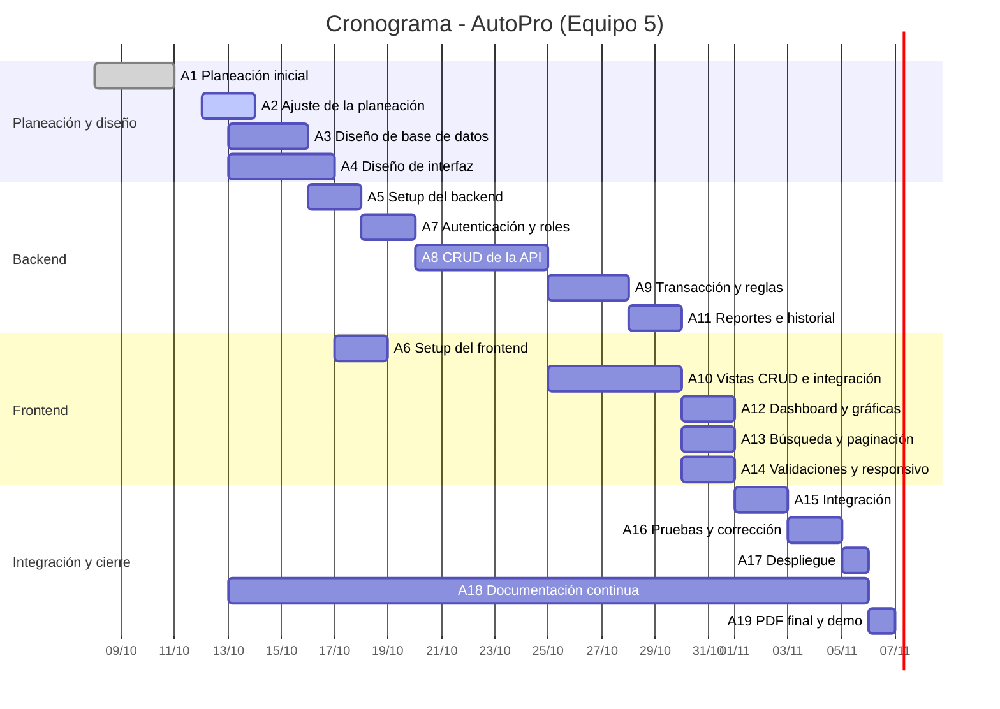
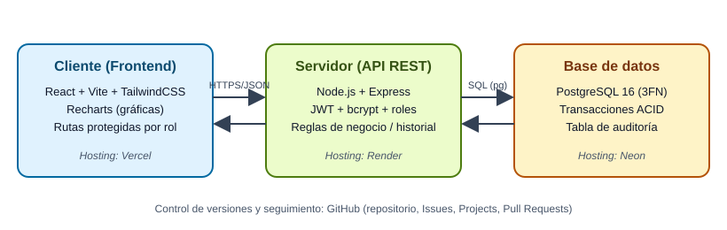

# Planeación y organización del proyecto final de software

**Proyecto:** AutoPro – Sistema de Gestión Automotriz (Taller Mecánico) · **Equipo 5** · **Versión 1.1 (12/10/2026)**
**Repositorio:** <https://github.com/excashh/gestion-automotriz->

## 1. Presentación y alcance del proyecto

### 1.1 Datos generales

**Nombre del proyecto:** AutoPro – Sistema de Gestión Automotriz (Taller Mecánico)
**Equipo:** 5
**Repositorio del proyecto:** <https://github.com/excashh/gestion-automotriz->

**Integrantes:**

* Martinez Piñera Yael Isai
* Rosales Fernandez Juan Emmanuel
* Montalvo Garcia Juan Pablo
* Santos Guerrero Luis Fernando
* Valadez Zuñiga Angel Uriel

### 1.2 Problema que atenderán

Los talleres mecánicos suelen llevar el registro de clientes, vehículos, diagnósticos e inventario de refacciones de forma manual o en hojas de cálculo aisladas. Esto genera pérdida de información, errores en presupuestos y cobros, falta de seguimiento en el historial del vehículo y pérdida de tiempo al consultar existencias de refacciones, afectando directamente la calidad del servicio al cliente.

### 1.3 Usuarios principales

1. **Administrador/Gerente:** control total del sistema, gestión de empleados, inventario, reportes, métricas e historial de operaciones.
2. **Mecánico/Recepción:** registro de clientes, recepción de vehículos, creación de órdenes de servicio y actualización del estado de las reparaciones.

### 1.4 Objetivo general

Desarrollar e implementar un sistema web integral (AutoPro) que centralice la información del taller mecánico, optimizando el registro de órdenes de servicio, el control de inventario de refacciones y el seguimiento del estado de los vehículos, para mejorar la eficiencia operativa y la atención al cliente.

### 1.5 Funciones de la versión final

*Tabla 1. Funciones de la versión final.*

| ID | Función | Descripción |
| :--- | :--- | :--- |
| F-01 | Autenticación y autorización | Inicio de sesión con JWT y contraseñas cifradas con bcrypt; acceso a pantallas y endpoints según rol (Administrador, Mecánico/Recepción). |
| F-02 | Gestión de usuarios (empleados) | Alta, consulta, edición y baja lógica de usuarios del sistema (solo Administrador). |
| F-03 | Gestión de clientes y vehículos | CRUD de clientes y de sus vehículos relacionados. |
| F-04 | Gestión de inventario de refacciones | CRUD de refacciones con stock actual y stock mínimo, y alerta de stock bajo. |
| F-05 | Órdenes de servicio (operación transaccional) | Creación de la orden asociando cliente, vehículo, servicios y refacciones; al finalizarla se descuenta el inventario dentro de una transacción (COMMIT/ROLLBACK). |
| F-06 | Registro interno de pagos | Registro de abonos y liquidaciones de una orden con cálculo de saldo (sin pasarela de pago). |
| F-07 | Historial de operaciones | Bitácora automática (usuario, acción, módulo, registro afectado, fecha y hora) de altas, cambios, bajas, cierre de órdenes y pagos; consultable por el Administrador con filtros por fecha, usuario y módulo. |
| F-08 | Reporte 1: Órdenes de servicio por rango de fechas | Listado de órdenes entre dos fechas con cliente, vehículo, estado y total, con totales del periodo; exportable a CSV/impresión. |
| F-09 | Reporte 2: Consumo de inventario y stock bajo | Refacciones utilizadas en un rango de fechas (cantidad e importe) y refacciones con stock igual o menor al mínimo; exportable a CSV/impresión. |
| F-10 | Dashboard con gráficas | Tarjetas de métricas y 2 gráficas con Recharts: órdenes por estado e ingresos por periodo con filtro de rango de fechas. |
| F-11 | Búsqueda, filtros, ordenamiento y paginación | En los listados de clientes, vehículos, refacciones, órdenes e historial. |

### 1.6 Reglas de negocio

Las siguientes cinco reglas se implementan en la API (y, cuando aplica, como restricción en la base de datos). Cada una tiene una actividad responsable (sección 3) y una prueba asociada (sección 7).

*Tabla 2. Reglas de negocio del sistema.*

| ID | Regla de negocio | Dónde se aplica | Actividad | Prueba |
| :--- | :--- | :--- | :--- | :--- |
| RN-01 | Una orden de servicio solo puede finalizarse si **todas** las refacciones tienen existencia suficiente; si alguna no alcanza, la operación completa se revierte (ROLLBACK) y el inventario no cambia. | API (transacción) + BD (`CHECK stock >= 0`) | A9 | P-RN-01 |
| RN-02 | Cada vehículo debe pertenecer a un cliente activo; la **placa es única** y el **VIN tiene exactamente 17 caracteres** alfanuméricos. | API + BD (`UNIQUE`, `CHECK`) | A3, A8 | P-RN-02 |
| RN-03 | Un pago **no puede exceder el saldo pendiente** de la orden; la orden cambia a estado "pagada" únicamente cuando el saldo llega a 0. | API (transacción) | A9 | P-RN-03 |
| RN-04 | Una orden **finalizada o cancelada no puede modificarse** (no se agregan ni quitan servicios/refacciones); los precios se congelan al momento de agregarlos a la orden. | API | A9 | P-RN-04 |
| RN-05 | Los clientes, vehículos y refacciones con historial **no se eliminan físicamente** (baja lógica) y solo el rol Administrador puede dar de baja registros o modificar precios. Toda baja queda en el historial de operaciones. | API (middleware de rol) + BD | A8 | P-RN-05 |

### 1.7 Exclusiones

* El sistema no procesará pagos con tarjeta (pasarelas de pago) ni emitirá facturación electrónica (CFDI ante el SAT); los pagos se registran de manera representativa en forma interna.
* No incluirá módulo de nóminas, agenda de citas en línea para clientes ni aplicación móvil nativa.

### 1.8 Restricciones

* **De tiempo:** el desarrollo cuenta con 4 semanas efectivas (13/10/2026 al 06/11/2026) con fecha de entrega fija. Cada integrante dispone de aproximadamente 10–12 horas por semana, compartidas con otras materias, por lo que no se agregarán funciones fuera de este alcance.
* **De conocimientos:** el equipo tiene experiencia básica en JavaScript y SQL, pero experiencia limitada en React/Recharts, transacciones en PostgreSQL y despliegue en la nube. Se mitiga con capacitación breve al inicio, programación en pares y la asignación de un "apoyo" por actividad (riesgo 3).
* **Técnicas:** el sistema requiere conexión a internet (modelo cliente-servidor). Se usarán planes gratuitos de hosting, con límites de almacenamiento y suspensión por inactividad (riesgo 6).
* **De presentación:** optimizado para escritorio y tablet, con diseño responsivo básico en móviles.

---

## 2. Identificación de requisitos y entregables

En la columna de evidencia se indica la evidencia **esperada**; ninguna se considera entregada hasta que la actividad correspondiente cumpla su criterio de término.

*Tabla 3. Matriz de requisitos obligatorios, actividades, responsables y evidencias esperadas.*

| Requisito obligatorio | Módulo | Actividad necesaria (ID) | Responsable | Evidencia esperada |
| :--- | :--- | :--- | :--- | :--- |
| Arquitectura cliente-servidor | Configuración | Setup del backend (A5) y del frontend (A6) | Montalvo J. (A5) / Martinez Y. (A6) | (Esperada) Repositorio con carpetas `backend/` y `frontend/` funcionando por separado. |
| BD con al menos 6 tablas en 3FN | Base de datos | Modelo relacional, diccionario y scripts (A3) | Rosales J. | (Esperada) Diagrama ER, diccionario de datos, `schema.sql` y `seed.sql`. |
| 3 módulos con CRUD y 12 endpoints | Backend / API | API REST de Clientes, Vehículos y Refacciones (A8) | Montalvo J. | (Esperada) Colección de Postman y `docs/api.md` con 12+ endpoints. |
| Autenticación, usuarios y 2 roles | Seguridad | JWT, bcrypt y middleware de roles (A7) | Santos L. | (Esperada) Código y prueba P-02 de acceso denegado (403). |
| Dashboard | Frontend | Vista de Dashboard con métricas (A12) | Valadez A. | (Esperada) Pantalla de Dashboard con datos reales. |
| 5 reglas de negocio | Backend / BD | RN-02 y RN-05 en A8; RN-01, RN-03 y RN-04 en A9; restricciones en BD en A3 | Valadez A. | (Esperada) Código de validación y resultados de P-RN-01 a P-RN-05. |
| 1 operación transaccional | Backend | Finalización de orden con descuento de inventario (A9) | Valadez A. | (Esperada) Evidencia de COMMIT y ROLLBACK (P-06, P-RN-01). |
| Historial de operaciones | Backend / Reportes | Registro automático (A9) y vista de consulta con filtros (A11) | Rosales J. | (Esperada) Tabla `auditoria` y pantalla "Historial" (P-11). |
| Buscador, filtros, ordenamiento y paginación | Interfaz | Listados con búsqueda y paginación (A13) | Martinez Y. | (Esperada) Listados funcionales (P-07). |
| 2 reportes | Reportes | Reporte de órdenes por fechas y reporte de inventario (A11) | Rosales J. | (Esperada) Pantalla de reportes con exportación (P-08, P-09). |
| 2 gráficas (1 con fechas) | Dashboard | Gráficas con Recharts (A12) | Valadez A. | (Esperada) Gráfica de órdenes por estado e ingresos por rango de fechas (P-10). |
| Validaciones, errores, seguridad, responsivo | UI / Seguridad | Validaciones, manejo de errores y diseño responsivo (A14) | Santos L. | (Esperada) Mensajes de error y pruebas P-12 y P-13. |
| Plan de pruebas ejecutado | Calidad | Ejecución del plan de pruebas (A16) | Santos L. | (Esperada) Tabla de resultados de pruebas con capturas. |
| Despliegue | Infraestructura | Publicación de frontend, API y BD (A17) | Montalvo J. | (Esperada) URL pública funcionando (P-14). |
| Git, README, doc. API, instalación | Documentación | Documentación continua (A18) | Montalvo J. | (Esperada) `README.md` y `docs/api.md` actualizados al cierre de cada fase. |
| Documentación final en PDF | Entrega | Integración del PDF final y demo (A19) | Valadez A. | (Esperada) PDF final con portada, índice y enlace al repositorio. |

---

## 3. Desglose de actividades y responsabilidades

La duración se expresa en días naturales.

*Tabla 4. Desglose de actividades, responsables, dependencias y criterios de término.*

| ID | Descripción de la actividad | Responsable principal | Apoyo | Duración | Dependencias | Entregable / Criterio de término |
| :--- | :--- | :--- | :--- | :--- | :--- | :--- |
| **A1** | Levantamiento de requerimientos y planeación inicial | Todos (coord. Martinez Y.) | – | 3 días | Ninguna | Documento de planeación v1.0 entregado. |
| **A2** | Ajuste de la planeación según retroalimentación | Martinez Y. | Todos | 2 días | A1 | Planeación v1.1 en PDF con todos los puntos observados atendidos. |
| **A3** | Diseño de BD: modelo ER (3FN), diccionario y restricciones de reglas de negocio | Rosales J. | Martinez Y. | 3 días | A2 | Diagrama ER, `schema.sql` y `seed.sql` ejecutan sin errores. |
| **A4** | Diseño de interfaz (mockups UI/UX en Figma) | Santos L. | Montalvo J. | 4 días | A2 | Mockups de login, dashboard, listados, orden, reportes e historial aprobados por el equipo. |
| **A5** | Setup del backend (Node/Express/PostgreSQL) | Montalvo J. | Valadez A. | 2 días | A3 | Servidor local corriendo y conectado a la BD. |
| **A6** | Setup del frontend (React, Vite, Tailwind) | Martinez Y. | Santos L. | 2 días | A4 | Proyecto React base con rutas y layout. |
| **A7** | Autenticación y roles (JWT, bcrypt, middleware) | Santos L. | Rosales J. | 2 días | A5 | Login funcional; endpoints protegidos responden 401/403. |
| **A8** | Endpoints CRUD de Clientes, Vehículos y Refacciones con RN-02 y RN-05 | Montalvo J. | Martinez Y. | 5 días | A7 | 12+ endpoints probados en Postman; P-03 a P-05, P-RN-02 y P-RN-05 aprobadas. |
| **A9** | Órdenes de servicio: transacción, pagos, RN-01, RN-03, RN-04 y registro del historial | Valadez A. | Rosales J. | 3 días | A8 | P-06, P-RN-01, P-RN-03 y P-RN-04 aprobadas; cada operación genera registro en `auditoria`. |
| **A10** | Vistas CRUD e integración con la API | Martinez Y. | Montalvo J. | 5 días | A6, A8 | Pantallas de clientes, vehículos, refacciones y órdenes consumiendo la API. |
| **A11** | Reportes (2) y consulta del historial de operaciones (API + vista) | Rosales J. | Valadez A. | 2 días | A9 | Reportes por fechas exportables y vista de historial con filtros (P-08, P-09, P-11). |
| **A12** | Dashboard y gráficas con Recharts | Valadez A. | Santos L. | 2 días | A10, A11 | Dashboard con 2 gráficas y filtro de fechas con datos reales (P-10). |
| **A13** | Búsqueda, filtros, ordenamiento y paginación | Martinez Y. | Santos L. | 2 días | A10 | Listados paginados y filtrables (P-07). |
| **A14** | Validaciones, manejo de errores y diseño responsivo | Santos L. | Martinez Y. | 2 días | A10 | Formularios validados y vistas adaptadas (P-12, P-13). |
| **A15** | Integración: unión de ramas, flujo completo y despliegue de prueba | Todos (coord. Montalvo J.) | – | 2 días | A9, A11, A12, A13, A14 | Rama `main` estable con el flujo completo funcionando en ambiente de prueba. |
| **A16** | Ejecución del plan de pruebas y corrección de errores | Todos (coord. Santos L.) | – | 2 días | A15 | Todas las pruebas de la sección 7 aprobadas, sin errores bloqueantes. |
| **A17** | Despliegue en producción (Vercel, Render, Neon) | Montalvo J. | Rosales J. | 1 día | A16 | URL pública accesible y prueba P-14 aprobada. |
| **A18** | Documentación continua: README, `docs/api.md`, bitácora y avance del PDF | Montalvo J. | Valadez A. | Continua (24 días) | A2 | Documentación actualizada en cada hito (18/10, 24/10, 31/10 y 05/11). |
| **A19** | Integración del PDF final y preparación de la demostración | Valadez A. | Todos | 1 día | A17, A18 | PDF final entregado con enlace al repositorio y guion de demo ensayado. |

---

## 4. Cronograma de trabajo

El proyecto contempla desde la planeación (08/10/2026) hasta la entrega final el **06 de noviembre de 2026**.

**Justificación del ajuste de fechas (v1.1):** la planeación inicial (A1) se realizó del 08 al 10/10/2026 según lo programado. Tras la retroalimentación recibida el 12/10/2026 se agregó la actividad A2 (ajuste de la planeación, 12–13/10) y se recorrió el inicio del diseño del 11/10 al 13/10. El desfase de 2 días se absorbió reduciendo la autenticación de 3 a 2 días y ejecutando en paralelo las actividades de frontend y backend que no dependen entre sí. La fecha de entrega final no cambia. El cambio queda registrado en la bitácora (sección 8).

*Tabla 5. Cronograma de trabajo.*

| Fase o actividad | Inicio | Fin | Responsable | Entregable estimado | Evidencia esperada | Estado |
| :--- | :--- | :--- | :--- | :--- | :--- | :--- |
| A1 Planeación inicial | 08/10/2026 | 10/10/2026 | Equipo | Planeación v1.0 | Documento entregado en Teams | Completado |
| A2 Ajuste de la planeación | 12/10/2026 | 13/10/2026 | Martinez Y. | Planeación v1.1 (PDF) | PDF con observaciones atendidas | En curso |
| A3 Diseño de base de datos | 13/10/2026 | 15/10/2026 | Rosales J. | Modelo ER y scripts SQL | Diagrama y archivos .sql en el repositorio | Planeado |
| A4 Diseño de interfaz | 13/10/2026 | 16/10/2026 | Santos L. | Mockups UI/UX | Enlace a Figma y capturas | Planeado |
| A5 Setup del backend | 16/10/2026 | 17/10/2026 | Montalvo J. | Servidor base | API respondiendo y conectada a la BD | Planeado |
| A6 Setup del frontend | 17/10/2026 | 18/10/2026 | Martinez Y. | Proyecto React base | Proyecto corriendo con rutas | Planeado |
| A7 Autenticación y roles | 18/10/2026 | 19/10/2026 | Santos L. | Login y middleware | Pruebas 401/403 en Postman | Planeado |
| A8 CRUD de la API | 20/10/2026 | 24/10/2026 | Montalvo J. | 12+ endpoints | Colección de Postman | Planeado |
| A9 Transacción y reglas de negocio | 25/10/2026 | 27/10/2026 | Valadez A. | Órdenes y pagos | Pruebas de COMMIT y ROLLBACK | Planeado |
| A10 Vistas CRUD e integración | 25/10/2026 | 29/10/2026 | Martinez Y. | Interfaz integrada | Pantallas consumiendo la API | Planeado |
| A11 Reportes e historial | 28/10/2026 | 29/10/2026 | Rosales J. | 2 reportes y vista de historial | Reportes exportados y capturas | Planeado |
| A12 Dashboard y gráficas | 30/10/2026 | 31/10/2026 | Valadez A. | Dashboard dinámico | Gráficas de Recharts con filtro de fechas | Planeado |
| A13 Búsqueda, filtros y paginación | 30/10/2026 | 31/10/2026 | Martinez Y. | Listados interactivos | Capturas de listados filtrados | Planeado |
| A14 Validaciones y responsivo | 30/10/2026 | 31/10/2026 | Santos L. | Formularios validados | Capturas en escritorio, tablet y móvil | Planeado |
| A15 Integración | 01/11/2026 | 02/11/2026 | Montalvo J. | Rama main estable | Pull Requests unidos y despliegue de prueba | Planeado |
| A16 Pruebas y corrección | 03/11/2026 | 04/11/2026 | Santos L. | Sistema estable | Tabla de resultados de pruebas | Planeado |
| A17 Despliegue | 05/11/2026 | 05/11/2026 | Montalvo J. | Sistema publicado | URL pública | Planeado |
| A18 Documentación continua | 13/10/2026 | 05/11/2026 | Montalvo J. | README, API y bitácora | Commits de documentación por hito | Planeado |
| A19 PDF final y demo | 06/11/2026 | 06/11/2026 | Valadez A. | PDF final y demo | PDF entregado y demostración | Planeado |

### 4.1 Diagrama de Gantt

*Figura 1. Diagrama de Gantt del proyecto (mismas fechas que la Tabla 5).*

---

## 5. Recursos y decisiones técnicas

### 5.1 Tecnologías

*Tabla 6. Tecnologías seleccionadas y justificación.*

| Área | Tecnología | Justificación |
| :--- | :--- | :--- |
| Frontend | React.js + Vite + TailwindCSS | React facilita interfaces dinámicas basadas en componentes; Vite compila muy rápido; Tailwind permite maquetar y hacer diseño responsivo sin escribir CSS extenso. |
| Gráficas | Recharts | Librería de gráficas para React, declarativa y fácil de alimentar con datos de la API. |
| Backend | Node.js + Express | Todo el stack en JavaScript unifica el conocimiento del equipo; Express es ligero y adecuado para APIs REST. |
| Base de datos | PostgreSQL 16 (librería `pg`) | Gestor relacional robusto con integridad referencial, restricciones `CHECK`/`UNIQUE` y transacciones ACID necesarias para la orden de servicio. |
| Seguridad | JWT + bcryptjs | Sesiones sin estado y contraseñas cifradas. |
| Diseño | Figma y Draw.io | Mockups de interfaz y diagrama entidad-relación. |
| Pruebas | Postman (colección de pruebas) y lista de verificación manual de UI | Permite repetir las pruebas de API en cada integración y documentar resultados. |
| Control de versiones | Git + GitHub (Issues, Projects, Pull Requests) | Historial por integrante, revisión de código y tablero Kanban. |
| Despliegue | Vercel (frontend), Render (API), Neon (PostgreSQL) | Planes gratuitos, despliegue automático desde GitHub y soporte para Node.js y PostgreSQL. |

### 5.2 Arquitectura

*Figura 2. Arquitectura cliente-servidor y servicios de hosting de AutoPro.*

### 5.3 Equipos, servicios y despliegue

*Tabla 7. Recursos materiales, servicios y su uso.*

| Recurso | Descripción | Uso en el proyecto | Costo |
| :--- | :--- | :--- | :--- |
| Equipos de cómputo | 5 laptops personales (Windows 10/11, mínimo 8 GB de RAM) | Desarrollo, pruebas locales y demostración | Propio |
| Conexión a internet | Conexión doméstica/escolar de cada integrante | Repositorio, servicios en la nube y reuniones | Propio |
| Software local | VS Code, Node.js 20 LTS, PostgreSQL 16, Git, Postman | Desarrollo y pruebas | Gratuito |
| GitHub | Repositorio, Issues, Projects y Pull Requests | Control de versiones, seguimiento y revisión de entregables | Gratuito |
| Vercel | Hosting del frontend (build de Vite) | Publicación de la interfaz | Plan gratuito |
| Render | Web Service para la API Node/Express | Publicación del backend | Plan gratuito |
| Neon | PostgreSQL administrado | Base de datos en producción | Plan gratuito |
| Microsoft Teams | Reuniones y entrega de documentos | Comunicación y seguimiento | Institucional |

**Estrategia de despliegue:** se realiza un despliegue de prueba durante la integración (A15) y el despliegue definitivo en A17. Las variables de entorno (`DATABASE_URL`, `JWT_SECRET`, `CORS_ORIGIN`) se configuran en cada servicio y nunca se suben al repositorio. Como plan de contingencia, el sistema puede ejecutarse localmente con el script `iniciar-autopro.bat`.

---

## 6. Riesgos y seguimiento

### 6.1 Riesgos

*Tabla 8. Matriz de riesgos.*

| Riesgo | Probabilidad | Impacto | Medida preventiva | Acción de respuesta | Responsable |
| :--- | :--- | :--- | :--- | :--- | :--- |
| **1. Retraso en el desarrollo del backend** | Media | Alto | Definir pronto los contratos de la API y respuestas de ejemplo (mock). | Reasignar al apoyo y a un integrante adicional al backend. | Montalvo J. |
| **2. Fallas en la integridad transaccional** | Media | Alto | Probar los bloques `BEGIN/COMMIT/ROLLBACK` con casos de error (P-RN-01). | Revisar y corregir el modelo relacional o las consultas. | Rosales J. |
| **3. Curva de aprendizaje en React/Recharts y despliegue** | Alta | Medio | Capacitación breve al inicio y documentación compartida. | Programación en pares para resolver dudas. | Martinez Y. |
| **4. Conflictos de integración (merge conflicts)** | Alta | Alto | Ramas por actividad y Pull Requests pequeños con revisión. | Sesión grupal para resolver conflictos paso a paso. | Santos L. |
| **5. Cambios o desviaciones del alcance** | Baja | Medio | Apegarse a este documento y a sus exclusiones. | Si afecta tiempos, se documenta en la bitácora y se descartan mejoras opcionales. | Valadez A. |
| **6. Fallas o límites del hosting gratuito** | Media | Medio | Despliegue de prueba anticipado en A15. | Cambiar de proveedor o realizar la demostración en local. | Montalvo J. |

### 6.2 Seguimiento del proyecto

* **Reuniones:** 2 veces por semana (martes y viernes, 20 minutos, por Teams) para revisar avances y bloqueos. Se levanta una minuta breve en la bitácora.
* **Herramientas:** cada actividad (A1–A19) es un *Issue* en GitHub Projects (tablero Kanban: Pendiente → En progreso → En revisión → Terminado), con su criterio de término como lista de verificación.
* **Bitácora de cambios:** todo cambio de fechas, responsables o alcance se registra en la sección 8 y en `docs/bitacora.md`, con su justificación, y se comunica al docente.

### 6.3 Revisión de entregables

1. El responsable trabaja en una rama `feature/Axx-descripcion` y entrega mediante un *Pull Request* que referencia su *Issue*.
2. El integrante de **apoyo** de la actividad revisa el *Pull Request*: verifica el criterio de término de la Tabla 4, ejecuta las pruebas asociadas de la sección 7 y revisa el código. Se requiere al menos 1 aprobación y el autor no puede unir su propio cambio.
3. Los documentos se revisan por un responsable fijo: README y documentación de la API, Montalvo J.; PDF de planeación y PDF final, Valadez A., con revisión cruzada de otro integrante.
4. En la reunión de los viernes se revisan los hitos contra el cronograma, se actualiza la columna "Estado" de la Tabla 5 y se registran las desviaciones.
5. **Definición de terminado:** cambio unido a `main`, pruebas asociadas aprobadas, documentación actualizada y evidencia (captura o enlace) adjunta al *Issue*.

---

## 7. Plan de pruebas y entrega

### 7.1 Plan de pruebas

Las pruebas de API se automatizan en una colección de Postman; las de interfaz se ejecutan con una lista de verificación manual. Los resultados (aprobada/fallida, fecha y captura) se registran en `docs/pruebas.md` y se integran al PDF final.

*Tabla 9. Casos de prueba de funciones principales.*

| ID | Tipo | Caso de prueba | Resultado esperado | Actividad | Responsable |
| :--- | :--- | :--- | :--- | :--- | :--- |
| P-01 | API / UI | Inicio de sesión con credenciales válidas e inválidas | 200 con token / 401 con mensaje de error | A7 | Santos L. |
| P-02 | Seguridad | Usuario Mecánico/Recepción accede a un endpoint de Administrador; petición sin token | 403 / 401 | A7 | Santos L. |
| P-03 | API | CRUD de clientes (crear, consultar, editar, baja lógica) | 201/200; registro marcado como inactivo | A8 | Montalvo J. |
| P-04 | API | CRUD de vehículos asociados a un cliente | 201/200; vehículo ligado al cliente | A8 | Montalvo J. |
| P-05 | API | CRUD de refacciones | 201/200; stock y precios actualizados | A8 | Montalvo J. |
| P-06 | Transacción | Crear y finalizar una orden con stock suficiente | COMMIT: stock disminuye y se registra el movimiento | A9 | Valadez A. |
| P-07 | UI / API | Búsqueda parcial, filtro por estado, ordenamiento y cambio de página | Resultados correctos y paginados | A13 | Martinez Y. |
| P-08 | Reporte | Reporte de órdenes entre dos fechas | Solo órdenes del periodo y total correcto; exportación CSV | A11 | Rosales J. |
| P-09 | Reporte | Reporte de consumo de inventario y stock bajo | Cantidades coinciden con los movimientos registrados | A11 | Rosales J. |
| P-10 | UI | Gráficas del dashboard con cambio de rango de fechas | Las gráficas se actualizan con datos del periodo | A12 | Valadez A. |
| P-11 | Historial | Crear, editar y dar de baja un registro y consultar el historial | Cada operación aparece con usuario, acción y fecha/hora | A11 | Rosales J. |
| P-12 | Validación | Enviar formularios con campos vacíos o formatos inválidos | Mensajes claros en UI y respuesta 400/422 sin detalles internos | A14 | Santos L. |
| P-13 | UI | Revisar vistas en escritorio, tablet y móvil | Contenido legible y utilizable | A14 | Santos L. |
| P-14 | Despliegue | Prueba básica en la URL pública (login, alta de cliente, orden) | Flujo completo funciona en producción | A17 | Montalvo J. |

*Tabla 10. Casos de prueba de reglas de negocio.*

| ID | Regla | Caso de prueba | Resultado esperado | Actividad | Responsable |
| :--- | :--- | :--- | :--- | :--- | :--- |
| P-RN-01 | RN-01 | Finalizar una orden con una refacción cuyo stock es menor a la cantidad solicitada | Error 409; ROLLBACK; el stock de **todas** las refacciones permanece igual | A9 | Valadez A. |
| P-RN-02 | RN-02 | Registrar un vehículo con placa repetida, con VIN de 16 caracteres y para un cliente inactivo | Rechazo 400/409 en los tres casos | A8 | Montalvo J. |
| P-RN-03 | RN-03 | Registrar un pago mayor al saldo; después, un pago que liquida exactamente el saldo | Primer pago rechazado; con el segundo, saldo = 0 y estado "pagada" | A9 | Valadez A. |
| P-RN-04 | RN-04 | Agregar una refacción a una orden finalizada; cambiar el precio de catálogo de una refacción ya usada | Rechazo 409; el total de la orden no cambia | A9 | Rosales J. |
| P-RN-05 | RN-05 | Eliminar un cliente con órdenes como Administrador y como Mecánico/Recepción | Administrador: baja lógica registrada en el historial; Mecánico/Recepción: 403 | A8 | Santos L. |

### 7.2 Lista de verificación para la entrega final

* [ ] Repositorio en GitHub (<https://github.com/excashh/gestion-automotriz->) con historial de commits de los 5 integrantes.
* [ ] Archivo `README.md` con instrucciones de instalación, variables de entorno y enlace al sistema desplegado.
* [ ] Script de base de datos `.sql` con datos de prueba.
* [ ] Documentación de los endpoints de la API (`docs/api.md` y colección de Postman).
* [ ] Sistema desplegado y accesible en URL pública (y ejecutable en local como respaldo).
* [ ] Resultados del plan de pruebas (Tablas 9 y 10) con evidencias.
* [ ] Documento PDF final con portada, índice, páginas numeradas, figuras identificadas y enlace al repositorio.
* [ ] Guion y ensayo de la demostración final.

---

## 8. Bitácora de cambios del documento

*Tabla 11. Bitácora de cambios.*

| Versión | Fecha | Cambio | Justificación | Responsable |
| :--- | :--- | :--- | :--- | :--- |
| 1.0 | 10/10/2026 | Versión inicial de la planeación. | Entrega de la planeación. | Equipo |
| 1.1 | 12/10/2026 | Se agregan las 5 reglas de negocio, el historial de operaciones, el segundo reporte, plan de pruebas por función y por regla, recursos de despliegue, restricciones de tiempo y conocimientos, revisión de entregables, fase de integración, diseño de interfaz en el cronograma y documentación continua. | Atender la retroalimentación del docente. | Martinez Y. |
| 1.1 | 12/10/2026 | Se recorren las fechas a partir del diseño (11/10 → 13/10) y se corrige la dependencia del frontend (A10 inicia al terminar A8). | La planeación original tenía fechas vencidas y una dependencia rota. | Martinez Y. |
| 1.1 | 12/10/2026 | Se unifica a Montalvo J. como responsable del README y a Valadez A. como responsable del PDF final. | Inconsistencia entre la matriz y el desglose. | Martinez Y. |
| 1.1 | 12/10/2026 | La columna de evidencias se marca como "esperada" y el documento se entrega en PDF. | Las evidencias aún no existen; formato de entrega requerido. | Valadez A. |
